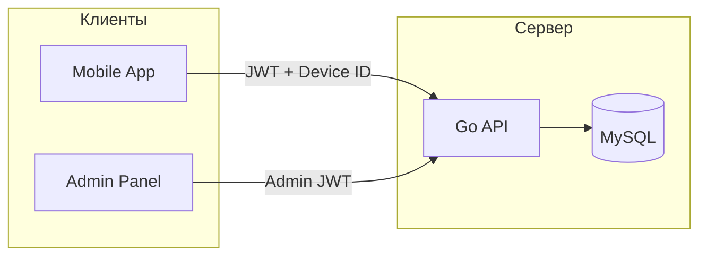
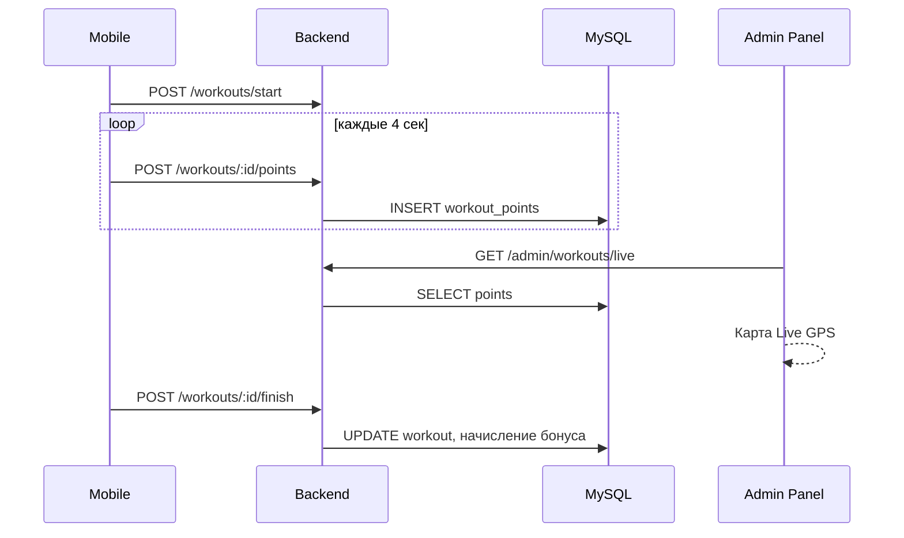

# Архитектура

## Обзор



## Репозиторий

| Папка | Стек | Порт (dev) |
|-------|------|------------|
| `backend/` | Go (chi, database/sql, coder/websocket) | 3001 |
| `mobile/` | Flutter (Dart), Android + iOS | — |
| `admin/` | React, Vite | 5174 |
| `database/` | SQL schema + migrations | — |

## Backend

Перенесён с Node.js на Go — см. [GO_MIGRATION.md](GO_MIGRATION.md).

```
backend/
├── cmd/api/           Точка входа; подкоманды setup-db, seed, daily-report
└── internal/
    ├── config, db     Конфиг из .env, пул MySQL, сериализация строк, setup/seed
    ├── httpx, server  JSON-ответы и ошибки, CORS, роутер, статика uploads
    ├── auth           JWT, привязка к устройству, middleware
    ├── users          SMS-вход, регистрация, профиль, аватар
    ├── shoes          QR и активация кроссовок, прогресс по паре
    ├── workouts       Тренировки, WebSocket /app/workout, Live GPS /admin/live-tracking
    ├── gps            Фильтр точек и антифрод-проверка трека
    ├── rewards        Прогресс по км, контрольные точки, награды, рейтинг
    ├── challenges     Задания с дедлайном
    ├── shop           Каталог, оплата/доставка, заказы, склад
    ├── ads            AdMob-конфиг, баннеры, рекламные кампании
    ├── notify         Telegram и Firebase (FCM HTTP v1)
    ├── reports        Отчёты админки, утренний отчёт
    └── admin          Маршруты /api/admin/**
```

## Mobile

```
mobile/lib/
├── main.dart, router.dart, app_state.dart
├── core/              API-клиент, хранилище, форматирование
├── services/          Награды, магазин, корзина, реклама, push
├── workout/           Трекер тренировки
│   ├── workout_tracker.dart   Сессия тренировки
│   ├── gps_filter.dart        Фильтрация GPS
│   ├── geolocation.dart       geolocator (фон / foreground-сервис)
│   └── native_workout.dart    Канал к нативному коду (шаги, Live Activity)
└── ui/                Тема, страницы, виджеты
```

### Нативные возможности

| Платформа | Функция |
|-----------|---------|
| Android | Foreground-сервис геолокации (geolocator), шагомер, SMS Retriever, карта OSM |
| iOS | CMPedometer, Live Activity (widget extension), карта MapKit |

## Admin

SPA без роутера по URL — навигация через `activeTab` в `App.jsx`.

Разделы: Dashboard, клиенты, QR/кроссовки, тренировки (Live GPS), бонусные счета, магазин, склад, отчёты, реклама.

## Поток тренировки



## Авторизация

### Пользователь (mobile)

- Вход по SMS OTP: `POST /api/auth/sms/send` → `POST /api/auth/sms/login`
- JWT в `Authorization: Bearer <token>`
- Заголовок `X-Device-Id` — привязка устройства (один телефон на аккаунт)

### Администратор

- `POST /api/admin/login` → JWT с `adminId`
- Роли: `super_admin`, `manager`, `seller`

## CORS

Разрешены: `localhost`, `capacitor://`, произвольные origin для dev. В продакшене рекомендуется ограничить список доменов.
